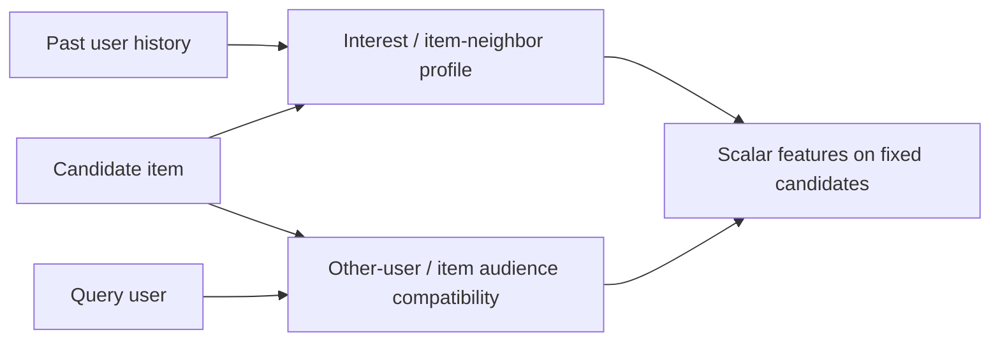

# User × item: совместимость в двух направлениях

15 октября 2026. Промежуточная публикация: готовы5 из8 независимых исследований; два cross-review ещё не завершены. Raw notes сохранены, их предложения не являются принятыми экспериментами.

| Направление | Готовые исследования |
|---|---|
| Кандидат относительно прошлых интересов пользователя | [Direct history](01-direct.md), [item neighbors](02-item-neighbors.md), [interest profile](04-interest-profile.md) |
| Пользователь относительно аудитории кандидата | [User neighbors](03-user-neighbors.md), [item audience](05-item-audience.md) |

Текущий compact MVP — direct counts/recency и exact category affinity в manual005. После общего review допустим bounded ItemCF mean/max/support на fixed C (TLAB012), сначала100 queries/cost gate. User-neighbor, audience и dense/profile ветви пока предложения. Similarity не означает complementarity или causal preference; self-exclusion зависит от заявленной семантики. Cold/missing/support сохраняются, параметры snapshots доступны до anchor, full Y/candidates неизменны внутри feature ablation. Learned-space, cross-construction, multi-interest/graph исследования, затем2 reviews и полный синтез остаются в очереди.

[Канонический backlog](../../backlog.md) · [Feature synthesis](../index.md).
