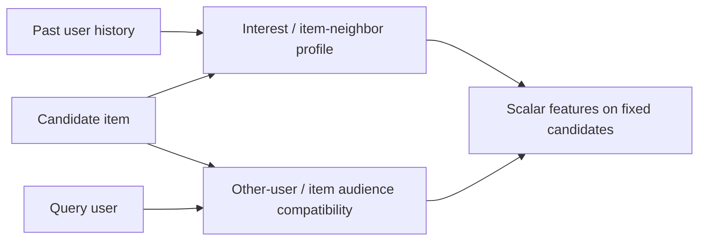

# User × item: совместимость в двух направлениях

15 октября 2026. Завершены8 независимых исследований и2 независимых cross-review. Исходные notes сохранены; material corrections явно отмечены appendix. Это исследовательский синтез, не измеренный прирост и не автоматическое разрешение всех экспериментов.

| Направление | Исследования |
|---|---|
| Кандидат относительно истории пользователя | [01 direct history](01-direct.md), [02 ItemCF](02-item-neighbors.md), [04 interest profile](04-interest-profile.md) |
| Пользователь относительно аудитории кандидата | [03 UserKNN](03-user-neighbors.md), [05 audience](05-item-audience.md) |
| Общее пространство и конструирование | [06 learned space](06-learned-space.md), [07 typed crosses](07-cross-construction.md), [08 graphs/multi-interest](08-graphs-multi-interest.md) |

[Review 01–04](review-01-04.md) и [review 05–08](review-05-08.md) согласуют компактный MVP: принятый manual18, затем один bounded ItemCF mean/max/support pilot на fixed C. Direct pair counts/recencies уже реализованы в005; добавлять повторные колонки не нужно. UserKNN, pre-action audience, ALS и graph extensions остаются альтернативными ветвями с собственным cost gate, а не обязательным ансамблем. Общая category share использует historical item×category numerator; категория ID сохраняется и без readable code. Self-exclusion определяется смыслом «другая аудитория», а не универсальным запретом собственной истории.

Нулевая cooccurrence отличается от отсутствующего top-K edge; missing/OOV, low support и zero norm имеют flags. Latest global metadata bucket<t включает все строки секунды, NULL/conflict без older-clean backoff. Fitted vocabulary/factors/priors доступны до первого downstream anchor, history обновляется отдельно. При изменении цены/metadata item-vector cache требует версии. ALS fold-in сравнивается с pooling на тех же V; HYP051/056 — одно семейство. Graph mixture weights считают retained seed mass; endpoint probabilities не заменяют visit counts. Typed grammar усиливает HYP002/TLAB016, mature target-rate encoders deferred.

Feature ablation сохраняет Q/C/full Y; retrieval меняет C и отдельно измеряет marginal coverage. Full Y вне C остаётся miss, zero-purchase queries сохраняются. Selection22–23 отделён от locked confirmation24–25; новые fits не используют confirmation. Similarity не доказывает complementarity или причинное предпочтение. Следующее решение — какой один P1 mechanism оправдан после tuned boosting и resource pilot; исходные авторские budgets не складываются.

[Backlog](../../backlog.md) · [Feature synthesis](../index.md) · [Embedding protocol](../../embedding-experiments.md).
