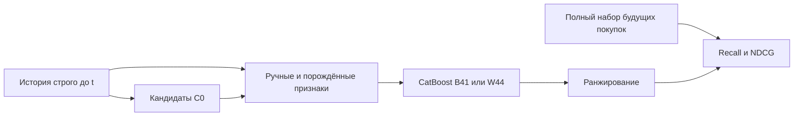

# Первая задача T-Lab: что сделано и что показал эксперимент

**Работает воспроизводимый конструктор событийных признаков и их сравнение с настроенным CatBoost. Устойчивый выигрыш качества не показан.** [Условие задачи](task1-requirements.md) допускает исследование автоматизации; положительный эффект нельзя подменять работоспособностью кода.

## Данные и задача

Использован REES46 Multi-category, октябрь 2019: 42,45 млн событий. Девять полей — `event_time`, `event_type`, `product_id`, `category_id`, `category_code`, `brand`, `price`, `user_id`, `user_session`. Есть действия view/cart/purchase, текстовые коды категорий и бренды; названий, описаний и изображений товаров нет. Показы рекомендаций также отсутствуют: непокупка не означает подтверждённый отказ. Источник, размер архива 1,74 GB и условия использования описаны в [паспорте данных](data.md).

Ежедневно в 00:00 UTC ранжируем покупки следующих 24 часов для пользователей с активностью за предыдущие 48 часов. До просмотра целей выбираются до 2000 пользователей в день. Список кандидатов C0 объединяет до 200 популярных товаров по различным покупателям за 7 дней и 20 последних различных товаров пользователя за 7 дней. Пересечения удаляются без дозаполнения; товары из будущих покупок не вставляются.



Признаки используют только `event_time<t`, окна `[t−W,t)`; события ровно в t исключены из глобальных агрегатов. Категории разрешаются по последнему прошлому временному bucket с явной обработкой конфликтов и пропусков. Полный Y содержит **все** покупки горизонта, включая товары вне кандидатов. Поэтому низкое покрытие нельзя скрыть удалением недоступных целей.

## Какие признаки получил бустинг

Ручной контроль B41 содержит 18 основных определений из [реестра](../configs/features/manual-18.json) и 23 контекстных/технических входа. Это 41 физическая координата модели.

| Основные признаки | Точные имена и смысл |
|---|---|
| История пользователя | `user_view_7d`, `user_cart_7d`, `user_purchase_7d` — количества событий; `user_distinct_viewed_items_7d` — различные просмотренные товары. |
| Пользователь × товар | `pair_view_7d`, `pair_cart_7d`, `pair_purchase_7d`; `pair_view_recency_seconds`, `pair_purchase_recency_seconds` — давность последнего наблюдавшегося действия. |
| История товара | `item_view_24h`, `item_purchase_24h`; `item_distinct_viewers_7d` — различные зрители. |
| Категорийная совместимость | `user_category_view_7d`, `user_category_view_share_7d`, `user_category_view_recency_seconds`; `item_category_view_7d`, `category_view_7d`, `item_category_view_share_7d` — счётчики, доли и давность. |

Остальные входы описывают источник кандидата и его ранг, популярность, давность последнего взаимодействия, наблюдаемую историю пользователя/товара, покрытие источника и пропуски. Например, `from_popular`, `popular_source_rank`, `retrieval_last_event_age_seconds`, `item_observed_age_seconds`. Последний означает возраст **наблюдаемой** истории, не реальный возраст товара. Восемь масок основных признаков сохраняют отличие неизвестного значения от нуля. Полный порядок всех 41 входа закреплён в [рецепте B/W](../configs/reproduction/frozen-bw-oct2019.json).

W44 добавляет три автоматически порождённых признака выбранного R2/L05:

| Имя | Семантика |
|---|---|
| `auto_item_view_count_distinct_24h_user_id` | Различные пользователи, просмотревшие товар за 24 часа. |
| `auto_item_cart_count_distinct_168h_user_id` | Различные пользователи, добавлявшие товар в корзину за 168 часов. |
| `auto_item_purchase_count_distinct_24h_user_id` | Различные покупатели товара за 24 часа. |

## Что автоматизировано

Человек задал роли полей, операторы, окна и шаблоны. [Конструктор](experiments/feature-programs.md) связывает их, порождает восемь допустимых наборов, проверяет типы/временные правила, удаляет aliases ручного контроля и рассчитывает физические зависимости, включая маски. Это rule-based генерация в ограниченной grammar, без произвольного SQL или обученного универсального proposer.

Проверены четыре заранее выделенных B+3-варианта: два заданных и два случайных. Победил случайный R2/L05; модель B+12 не обучалась. Это демонстрирует автоматизацию, но не превосходство направленного поиска. [Пример генерации без данных](experiments/automation-walkthrough.md) использует существующий API.

## Что показали проверки

Train — 8–20 октября, selection — 22–23: 26000/4000 запросов. Для selection есть 73 запроса с покупками. Основная метрика — NDCG@20, усреднённый по запросам с непустым полным Y; Recall сообщается отдельно.

| Проверка | B: NDCG@20 | W: NDCG@20 | Разница W−B |
|---|---:|---:|---:|
| Frozen final 26–31 октября, 300 деревьев | 0.459825 | 0.464947 | +0.005122; 95% CI [−0.010433; +0.018561] |
| Development, seed2026, собственный лучший префикс | 0.460208, 1189 деревьев | 0.465646, 403 дерева | +0.005438 |
| Development, seed2027, собственный лучший префикс | 0.450401, 98 деревьев | 0.433256, 134 дерева | −0.017145 |

Модели и признаки frozen final закреплены до открытия его целей; после оценки они не менялись. Интервал пересекает ноль. Позднейшие [адаптивные повторы](backlog-reviews/seed-replication-results.md) выбирают префикс после полного обучения до 1200 деревьев на той же reused validation. Это не CV, ранняя остановка или свежая финальная оценка. Положительный эффект между двумя seeds не повторился; прежний final сохранён.

[Категорийный retriever](backlog-reviews/category-candidate-pilot-results.md) нашёл 93/121 цели против 92/121, но новых пар — 20 против 21. Интервал разницы покрытия пересекает ноль: результат inconclusive, C0 сохраняется. [Oracle-диагностика](backlog-reviews/candidate-oracle-diagnostic.md) для selection даёт потолок NDCG 0.694231: разрывы есть и у кандидатов, и у ранжирования; это не обещание достижимого прироста. Для HYP-061 независимый расчёт подтвердил три графа и все 6000 наборов кандидатов, включая прежние 100. [Проверка покрытия](backlog-reviews/covis-coverage-results.md) дала cosine 95/121 целей против 92/121 у C0: разница query-macro Recall +0.02403846, 95% CI [0; +0.05603549]. Нижняя граница равна нулю, поэтому критерий продолжения не выполнен и C0 сохраняется. Это покрытие полного списка кандидатов на той же исторической когорте; качество ранжирования здесь не измерялось.

[Текущий код пересоздал 15 коллекций](backlog-reviews/current-collection-refresh-results.md) из той же processed DB: все 75 Parquet побайтно совпали с принятыми историческими. Это проверка текущего пути на данной базе, без нового raw import, независимого пересчёта истинности формул или новых моделей.

## Как воспроизвести

Для короткой демонстрации без исходных данных:

```bash
uv sync --frozen --python 3.12
uv run --locked python -m scripts.replay_ranking_claim --package tests/fixtures/reproduction/manual18-small
```

В пакете 12 синтетических записей Q/C/Y/score; обучения нет. [Полный маршрут из raw](experiments/reproduce-frozen-comparison.md) заново строит коллекции и обучает две fixed300-модели:

```bash
uv run --frozen python -m scripts.reproduce_frozen_comparison \
  --raw data/raw/2019-Oct.csv.gz \
  --output artifacts/public-frozen-comparison-01 \
  --recipe configs/reproduction/frozen-bw-oct2019.json \
  --cpu-seconds "$CPU_SECONDS" --wall-seconds "$WALL_SECONDS" \
  --rss-bytes "$RSS_BYTES" --spill-bytes "$SPILL_BYTES"
```

Архив нужен локально; ресурсные переменные задаются явно, выходной каталог должен отсутствовать. Инструкция указывает минимальный scratch 40 GiB и spill 8 GiB. Полный повтор принят на Mac в новом locked-окружении; он воспроизводит выбранный development-рецепт, а не весь поиск или frozen final.

Приняты 14 из 19 крупных задач; TLAB-014 продолжает исследования, TLAB-010–013 — необязательные отложенные ветви. Подробные доказательства и ограничения находятся в [экспериментальном отчёте](experimental-report.md), следующая работа — в [едином backlog](backlog.md).
