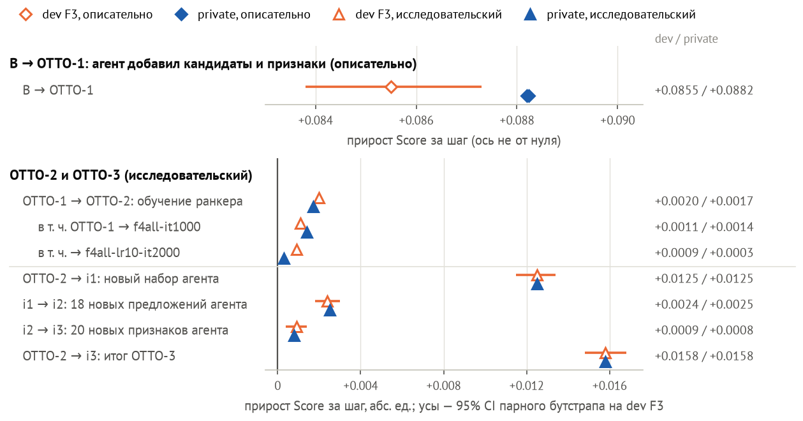

# Признаки LLM-агента и DFS поверх ручных помогают настроенному бустингу на REES46 (+2.0% NDCG@20), но ручных не заменяют

Отбор T-Lab 2026, RecSys, задача 1. Код и документы написал, большую часть исследовательских решений принял Claude Code (Claude Opus 5.5) под руководством автора (разд. 9).

**Ответ.** Задача — рекомендовать в магазине REES46 товары, новые для пользователя. LLM-агента, который пишет SQL-признаки по событиям до момента рекомендации, и DFS (Deep Feature Synthesis, сетка оконных агрегатов) сравнили с CatBoost на 80 ручных признаках, настроенным по одному гиперпараметру за раз. Из веток, открытых на тесте, базу обыграла только вся автоматика без отбора: все колонки агента и DFS поверх ручных признаков дали +2.0% NDCG@20 (+0.0030) на свежем тесте 2020, доверительный интервал (CI) выше нуля в обоих запусках с разным зерном [по протоколу]; эту гипотезу записали после теста 2019 и до теста 2020. Заменить ручные признаки автоматика не смогла: −0.77% на тесте 2020 при настройках базы [по протоколу] и −1.68% на подтверждающей половине валидации 2019 [описательно]. Пошаговый отбор агента оставил 1 предложение из 30 с приростом ниже порога шума ≈0.001; DFS (20 лучших агрегатов) отдельно прироста не дал [по протоколу].

За пределами REES46: на отложенных неделях (holdout) Tinkoff и СберМаркета колонки агента подняли базу [holdout с отклонением], на Kaggle у Tinkoff они ниже базы, у H&M не различены, у СберМаркета не проверены [описательно]. OTTO (соревнование Kaggle), где агент строит и кандидатов, — разведка [OTTO-1 описательно, OTTO-2/3 исследовательский].

**Метки доказательности** стоят у чисел в выводах. Контракт (предрегистрация, спецификация) — ветки, пороги и правила чтения, записанные в Git до чисел; «да» — отдельное разрешение автора.
- **[по протоколу]** — выбор на валидации, тест открыт один раз для вердикта по замороженной спецификации, 95% CI парного бутстрапа по запросам; числа двух половин валидации до теста 2019 — этапы [по протоколу: выбор] и [по протоколу: подтверждение].
- **[holdout с отклонением]** — правило чтения записано заранее, но отложенные данные открыты без отдельного «да» по контракту или после отклонения от него.
- **[описательно]** — без проверки по протоколу; разборы после теста — «описательно (post-hoc)».
- **[исследовательский]** — OTTO-2 и OTTO-3: недели для выбора и Kaggle читались многократно.

**Табл. 1. Пункты условия и что по ним сделано.**

| Пункт условия | Что сделано и результат | Метка |
|---|---|---|
| Ручной бустинг | CatBoost, 6 источников кандидатов, 80 признаков: спроектировал Claude Code, 3 — автор, вошли идеи первого запуска агента; NDCG@20 0.1442 (тест 2019), 0.1462 (тест 2020) | по протоколу |
| Автоматизация | LLM-агент: 30 SQL-предложений, пошаговый отбор; DFS: 128 оконных агрегатов, 20 лучших | — |
| Лучше базы? | поверх ручных — да: агент и DFS вместе, без отбора, +2.0%; вместо ручных — нет, −0.77%; лучший одиночный признак +0.55%, ниже порога | по протоколу |
| Проверка | выбор и подтверждение на разных половинах валидации; тесты 2019 и 2020 открыты по разу, тест 2020 перечитал совет агентов (разд. 6); плацебо (колонки, перемешанные внутри дня) прироста не даёт: прирост несёт содержание [описательно (post-hoc), разд. 5] | по протоколу |
| Утечки | признаки только из событий до t, построчная сверка с журналом, обрезанным по t; до использования пойманы категория «из будущего» (2020) и обход песочницы | — |

## 1. Задача и данные

- **Запрос и цель.** REES46 — журнал событий интернет-магазина за октябрь–ноябрь 2019 и, для повтора во времени, январь–февраль 2020. Момент рекомендации t — начало дня; ранжируются товары, которых пользователь до t не касался. Цель — первая корзина или покупка такого товара за 24 ч: журнал корзин неполон, у 56.0% первых покупок товара в октябре 2019 корзины перед ними нет. Запрос — пользователь, активный за 48 ч до t и имеющий цель (0.78–1.55% активных на днях обучения и валидации 2019); метрика считается только по ним.
- **Метрика и разбиение.** NDCG@20 — качество порядка первых 20 рекомендаций по всем целям запроса, включая не попавшие в кандидаты. 2019: обучение 15.10–07.11; валидация 08–13.11, поделённая по пользователям на половину для выбора и подтверждающую; тест 18–28.11 (72 709 запросов). 2020: тест 14–29.02 без 27–28.02 (27.02 в журнале сломан; 97 656 запросов).
- **Почему новые товары.** Когда целью были все покупки, правило без модели «сначала недавние товары пользователя» нашло 50 из 58 повторных покупок, а их пользователь сделал бы и без ленты. Цена выбора: прямые признаки «пользователь × товар» для кандидатов пусты.

![Рис. 1. Из веток с новыми признаками на тесте 2020 порог шума прошла только вся автоматика без отбора; замена ручных признаков ниже базы. Ромбы — подтверждающая половина 2019, прочитанная после теста [описательно].](fig/fig-rees46-verdict.png)

## 2. Метод

**База.** Шесть источников кандидатов (популярное, самые популярные товары в категориях и брендах пользователя, соседи его недавних товаров по совместным просмотрам, переходы «просмотр → покупка») и 80 признаков в восьми группах. CatBoost 1.2.10: Logloss, глубина 8, 500 деревьев, два зерна (начальные значения генератора случайных чисел). «Ручные» значит «спроектированные по спецификации»: их спроектировал Claude Code, автор предложил 3 из 80. В базу вошли и идеи первого запуска агента (склонность к бренду, совместные просмотры в сессиях, переходы «просмотр → покупка»), поэтому вклад автоматики «с нуля» не измерен.

**LLM-агент.** Шесть раундов: промпт → предложения (идея и SQL для DuckDB, одна или несколько колонок) → песочница считает каждое предложение по событиям до t → база переобучается с ним → приём, если на половине для выбора CI выше нуля и прирост больше 0.0005 на обоих зёрнах. Строк данных и меток в промпте нет; со второго раунда в него добавляются эффекты прошлых предложений на половине для выбора; `claude -p` вызывается без инструментов. Итог: 6 вызовов, 30 предложений, 66 колонок, принят один признак. **DFS — контроль без LLM:** 128 оконных агрегатов по товару, категории, бренду и пользователю; 20 лучших из 96 колонок, допущенных к отбору, — по важности на обучении.

**Ветки:** база; база + лучший признак агента; база + DFS, 20 лучших; «база + вся автоматика без отбора» (66 колонок агента и 128 DFS, 274 признака); «автоматика вместо ручных признаков» (ранги товара в шести источниках кандидатов и вся автоматика, 200 признаков).

## 3. Протокол

- **Сравнение** — разность NDCG@20 двух моделей на одних запросах, 95% CI парного бутстрапа по запросам. Разброс зёрен CI не учитывает, поэтому каждая ветка обучена на двух зёрнах. Решения принимаются на половине для выбора, подтверждающая половина только проверяет.
- **Порог ≈0.001.** При выборе порога три зерна на половине для выбора расходились до 0.0005. Пары моделей, отличающихся только зерном, расходятся на подтверждающей половине до 0.0013; у 2 из 10 таких пар CI не накрывает ноль [описательно: пересчёт вне Git]. Разности меньше порога не считаются установленными даже при CI выше нуля.
- **Тесты** открыты по разу для своих вердиктов, по замороженной спецификации: 2019 запустил автор, 2020 — Claude Code с его разрешения. Гипотеза «всё без отбора» возникла после теста 2019 (+0.0022 на подтверждающей половине [описательно]); правило для 2020 записано до него: от +0.0015 на каждом зерне при CI выше нуля.

**Отступления от протокола.** (1) Первые 11 прогонов показывали и метрики подтверждающей половины; (2) глубину 8 приняли при CI выше нуля только на одном зерне, хотя агенту требовалось на двух — оба отступления в пользу ручной ветки (оценка полного отчёта). (3) Ветку агента добавили в тест 2019 после того, как её прирост не подтвердился, за 3 мин до запуска. (4) В 2020 последнюю дописку к предрегистрации сделали, когда числа проверочной сборки на валидации уже были видны; ветки и пороги она не меняла. У (3) и (4) направление не записано. (5) В разборе подтверждающей половины 2019 правило для «всей автоматики без отбора» ужесточили после запуска прогонов, но до обучения её веток: порог +0.0015 — на каждом зерне. (6) Отложенные недели Tinkoff и СберМаркета открыты без отдельного «да».

**Сколько раз читали метки.** Тест 2020 и отложенные недели Tinkoff и СберМаркета после вердиктов повторно прочитал совет агентов. Половину для выбора ручная ветка видела 27 раз, агент — 38 (прошлые эффекты были в промпте), DFS — 2. Подтверждающую половину 2019 и валидацию 2020 читали и в разборах после теста 2019, поэтому их числа после него — [описательно].

## 4. Защита от утечек

Признаки читают только события до t; будущее окно определяет только метки и то, какие запросы оцениваются, в признаки оно не попадает. Проверка утечек (дни 22.10 и 11.11.2019, 22.01.2020) строит признаки дня по полному журналу и по журналу, обрезанному по t, и сравнивает все колонки построчно; SQL агента идёт в песочнице DuckDB, где есть только события до t; LLM не видит ни строк данных, ни меток.

**Табл. 2. Что нашли проверки и как закрыли.**

| Что нашли | Чем поймали | Как закрыли |
|---|---|---|
| REES46, 2020: код категории брался за весь период, а у 19 категорий он появляется лишь 01–05.02 — из будущего | тест на утечки | код — из событий до t; таблицы 2020 пересобраны до обучения моделей |
| обход песочницы через функцию DuckDB `json_execute_serialized_sql` | ревью кода | закрыт до первого раунда агента |
| OTTO: 4 колонки агента на dev-неделе разошлись между полным журналом и журналом без продолжений сессий | тест на утечки | не утечка: порядок округлений при параллельном суммировании; в один поток проверка прошла |
| скрытое использование меток в SQL агента — не найдено | аудит SQL | чисто на H&M, Tinkoff, СберМаркете и в OTTO; на REES46 — песочница |

Аудит SQL вёл отдельный экземпляр Claude без права правки. Найдено, но на вердикт не влияет: аудитор Tinkoff до открытия отложенной недели посчитал корреляцию по событиям её окна цели; набор агента был заморожен раньше. «Утечек нет» не утверждаем: проверено перечисленное.

## 5. Результаты на REES46

- **Вся автоматика без отбора** (рис. 1): +0.0031 и +0.0029 по зёрнам на тесте 2020, правило выполнено; +2.0% [по протоколу]. На всех 16 днях, включая 27–28.02, вердикты те же.
- **Лучший признак агента:** +0.0004 на тесте 2019 (CI накрывает ноль) и +0.0008 на тесте 2020: CI выше нуля, но прирост ниже порога ≈0.001 и не установлен. **DFS:** −0.0008 на тесте 2019 (CI ниже нуля) и −0.0003 на тесте 2020 (CI ниже нуля, верхняя граница −0.00001) [по протоколу].
- **Плацебо** (на валидации, после обоих тестов): те же 194 колонки перемешаны по строкам внутри дня — число и распределения колонок прежние, связь с парой пользователь–товар разрушена. Настоящие колонки лучше перемешанных на 0.0025–0.0043, а перемешанные меняют базу на −0.0008…−0.0003. Значит, прирост даёт содержание колонок, а не их число; по разложению на тех же данных его несут в основном колонки агента, одни DFS базу не поднимают [описательно (post-hoc); на 2019 оценка вклада агента смещена: его таблицы подбирались по половине для выбора 2019]. На тесте состав прироста не разделён.
- **Кандидаты — узкое место:** около половины целей и больше вне кандидатов — ≈48% на валидации 2019 [описательно, пересчёт вне Git], ≈58% на 29.01–02.02.2020 [описательно (post-hoc)]. Новые источники — наибольший прирост на тесте 2019: +0.0036, +2.5% (вместе с глубиной 8); на тесте 2020 при равной глубине повторились: +0.0021, +1.4% [по протоколу]. Их спроектировал Claude Code, агент на REES46 пишет только признаки.

**Пошаговый отбор: завышение при выборе.** Приросты 30 предложений на половине для выбора (первое зерно) — от −0.0006 до +0.0013, стандартное отклонение 0.0004; без эффекта лучшее из 30 ожидалось бы около +0.0008 [описательно, расчёт]. Принятый признак прошёл путь +0.0013 и +0.0017 [по протоколу: выбор] → +0.0004 с CI через ноль [по протоколу: подтверждение] → +0.0004 и +0.0008 на тестах: завышение поймала подтверждающая половина, а не порог приёма. Прямого теста «пошагово против всего сразу» нет: оба числа — сравнения с базой, а «все колонки» включают и DFS. При приёме таблиц агента группами по пять на половине для выбора прошла одна группа; на подтверждающей половине она дала +0.0018 против +0.0028 у всех таблиц сразу, отставание ниже порога [описательно (post-hoc)]. Синергия это или сумма мелких эффектов, не различено.

**Заменяет ли автоматика ручные признаки.** Если оставить из ручных только ранги источников, база теряет 0.0171 на подтверждающей половине 2019 [описательно] и 0.0167 на тесте 2020 [по протоколу]. Автоматика возвращает 85% и 93% этого вклада, но уступает базе: −1.68% [описательно] и −0.77% [по протоколу], CI ниже нуля. Одни колонки агента возвращают 78% (смещено: таблицы агента подбирались по половине для выбора 2019), одни DFS — 25% (2019, описательно). На тесте 2020 разность −0.0011 лишь чуть больше порога ≈0.001 (уровни моделей на этом тесте расходятся по зёрнам до 0.0004 [по протоколу]); ветку на 200 признаках не перенастраивали, поэтому вывод относится к настройкам базы.

**Насколько настроен бустинг.** До теста — по одному гиперпараметру за раз на половине для выбора: глубина 8 принята (+0.0010 и +0.0008), 1000 деревьев отвергнуты (+0.0002), трудные негативы обрушили NDCG до 0.0991 [по протоколу: выбор]; сочетания не проверялись. После теста выигрыша не дали глубина 10 и YetiRank у базы, пять значений трёх гиперпараметров у всей автоматики и ранняя остановка у обеих [описательно (post-hoc)]; плато это не доказывает. Бюджеты не выравнивались: ручная настройка — 16 подгонок, ≈2.1 ч; агент ≈4.8 ч; отбор DFS 555 с. Недонастройка облегчает выигрыш автоматике, но ветки «вместо ручных», плацебо, переноса и совета не настраивались.

## 6. Границы вывода

### Перенос на H&M, Tinkoff и СберМаркет

Переносилась агентская половина: новый запуск агента на наборе и все его валидные колонки поверх ручной базы набора, без DFS и перенастройки бустинга.

**Табл. 3. База + колонки агента против базы.**

| Набор | Отложенные данные | Kaggle private |
|---|---|---|
| Tinkoff, NDCG@20 | +6.2% и +3.6% по зёрнам [holdout с отклонением] | ниже базы, ≈−7.6% [описательно] |
| СберМаркет, MAP@50 | +2.6% на обоих зёрнах [holdout с отклонением] | не проверен: на Kaggle колонки чаще пусты, чем на обучении, и не отправлялись |
| H&M, MAP@12 | отложенной недели нет; неделя валидации +8.9% [описательно] | «не различено» [описательно] |

Отложенные недели Tinkoff и СберМаркета открыты по общей фразе автора, без отдельного «да», как и первые посылки Tinkoff. Технические отклонения записаны в Git позже, чем применены; на значения это не влияет. Базы собрал Claude Code, знавший эти соревнования, — знание публичных решений не исключено; промпт агента соревнование не называет, но схема данных узнаваема. На отложенных неделях запрос — пользователь с целью в окне, а Kaggle оценивает другую популяцию.

У Tinkoff прирост есть только на отложенной неделе: на валидации CI накрывает ноль, на Kaggle колонки ниже базы на обоих зёрнах, причины не проверены. Своей отложенной недели у H&M нет: неделя валидации была отложенной в прежнем эксперименте, поэтому не свежая. MAP@12 на ней считается только по 1 905 покупателям, CI второго зерна накрывает ноль, а на Kaggle 853 060 из 1 371 980 клиентов получают одинаковый популярный ответ. Промпт агента на H&M набор не скрывает, а LLM знает решения этого соревнования. Правило сравнения на Kaggle (обе посылки одного варианта выше обеих посылок другого с запасом больше разброса зёрен) без эффекта ошибается примерно в 11% случаев в каждую сторону, а прирост такой величины, как на REES46, при двух зёрнах не различает. Мест на лидербордах не заявляем: посылки поздние.

### Совет агентов

Совет: LLM-генераторы и критики предлагают семейства признаков поверх всей автоматики, затем отбор вычёркивает вредные; сравнение — с моделью на том же числе признаков без отбора. Исход «не различено» записан в контракте до кода и вышел на REES46 (тест 2020), Tinkoff и СберМаркете [описательно: повторное чтение открытых меток]; «не различено» не значит «равны». Отбор не включился: на REES46 не хватило мощности, на Tinkoff не прошла предварительная проверка критерия (калибровка), на СберМаркете вредных семейств не нашлось. Поэтому проверена генерация совета, а не отбор; эффекты меньше разрешения теста не исключены.

### OTTO: агент строит и кандидатов

OTTO — соревнование Kaggle: по началу сессии предсказать до 20 товаров для кликов, корзин и заказов; Score = 0.1·R_clicks + 0.3·R_carts + 0.6·R_orders, R — Recall@20. На вопрос о настроенном бустинге OTTO не отвечает: база намеренно простая (история сессии и популярность, ранкер без настройки). Агент пишет SQL таблиц «товар × товар», источников кандидатов и признаков внутри лимитов; двухэтапную схему, лимиты, ранкер и правила выбора и остановки задавал Claude Code, итерации шли по просьбам автора. F3 — dev-неделя для выбора, F5 — неделя Kaggle; потолок кандидатов — Score по всем кандидатам сессии, верхняя граница для ранкера.

**Табл. 4. Лестница OTTO.** Сравнимы приросты, не уровни; private базы и OTTO-1 — среднее двух зёрен.

| Шаг | dev F3 | Потолок F3 | Private | Посылок | Метка |
|---|---|---|---|---|---|
| простая база | 0.4778 | 0.4824 | 0.4906 | 2 | описательно |
| OTTO-1: кандидаты и признаки агента | 0.5633 | 0.6039 | 0.5788 | 2 | описательно |
| OTTO-2: переобучен только ранкер | 0.5653 | 0.6039 | 0.5805 | 2 | исследовательский |
| OTTO-3 `i1`: новый прогон агента, шире лимиты | 0.5777 | 0.6514 | 0.5930 | 1 | исследовательский |
| OTTO-3 `i2`: `i1` и 18 новых предложений агента | 0.5802 | 0.6639 | 0.5955 | 1 | исследовательский |
| OTTO-3 `i3`: `i2` и 20 новых признаков агента | 0.5810 | 0.6639 | 0.5963 | 1 | исследовательский |

На шагах OTTO-2 и OTTO-3 посылку выбирали по F3 правилом, записанным заранее; приросты dev и private совпали по знаку на всех шагах (рис. 2). На dev шаги OTTO-3 больше разброса выборки сессий (95% CI выше нуля, но без учёта отбора на F3, зерна модели и запуска агента): OTTO-2 → `i1` +0.0125, `i1` → `i2` +0.0024, `i2` → `i3` +0.0009 [исследовательский]; у последнего шага CI по заказам задевает ноль. Переобучение ранкера дало +0.0017 private, новые наборы агента в расширенных лимитах на том же ранкере — +0.0158. Рост шёл вместе с ростом потолка кандидатов; вклад не разделён. Лучший private — 0.5963 <!--OTTO-BEST--> у `i3` [исследовательский]; итераций после неё нет.

**Чего лестница не доказывает.**
- **Это не проверка по протоколу.** По контракту простая база должна была быть не хуже правила без модели (история сессии, затем популярные товары) по каждому типу действий; по кликам она уступила 0.0016. Сравнение перенесли на общий Score после dev-чисел, с согласия автора, поэтому числа отложенной недели и Kaggle не подтверждающие.
- **Неделя Kaggle прочитана 9 <!--F5-READS--> раз.** Правило «стоп при private ≥ 0.590», записанное до результатов, сработало на `i1`; после этого чтения работу продолжили по просьбе автора: ещё две посылки, `i2` и `i3`, — предел, записанный заранее.
- **Придумано или вспомнено — не различается.** Аудитор по памяти счёл общеизвестными 21 из 24 предложений OTTO-1, 30 из 33 в `i1`, 46 из 51 в `i2` и 64 из 71 в `i3`; признак `i2` с весами типов 1/6/3, по его памяти, повторяет веса известного публичного решения. Пересказ части одного из публичных решений OTTO попал в отчёт задачи 1 до контракта; промпт соревнование не называет, с решениями не сверяли. Схему, базу и лимиты задал Claude Code, который тоже знает OTTO.
- **Лестница — не один эксперимент.** Простую базу с ранкером OTTO-2 не обучали; шаг к `i1` смешивает новые лимиты и новый запуск агента; каждый набор — один прогон агента и одна модель.
- **Dev смещён:** агент видел recall на пробе той же недели, по F3 выбирали рецепты и итерации, а F3 входит в историю финальных моделей OTTO-2/3; несмещённая оценка — только private.
- **Постановка трансдуктивная:** признаки видят более поздние события других сессий той же недели — Kaggle их выдаёт, в онлайн-системе их нет. Посылки поздние, место не заявляется.

## 7. Цена: генерировать дёшево, отбирать трудно

Из ≈4.8 ч работы агента на REES46 LLM заняла 1014 с (5.8%; $2.89 за 6 вызовов по оценке клиента `claude -p`), переобучение базы для 30 предложений — 12 181 с. Предложение стоит ≈34 с LLM и ≈$0.10, его проверка — в среднем 406 с. Для сотен предложений нужны дешёвая оценка, своя подтверждающая половина внутри цикла и поправка на множественные проверки.

## 8. Ограничения

Сверх сказанного: один магазин; главный положительный результат — один тест 2020 на двух зёрнах, на тесте 2019 этой ветки не было, так что повтора во времени у неё нет; шум зёрен — локальный пересчёт вне Git; оба тестовых периода REES46 уже открыты, свежего теста не осталось.

## 9. Участие ИИ

**Автор** выбрал задачу 1 и проверку гипотез, возразил против первой постановки и предложил цель «первая корзина или первая покупка» и 3 из 80 признаков. Из двух направлений, предложенных Claude Code, он выбрал работу над кандидатами, выбрал спецификацию теста 2019 с веткой агента и сам его запустил. Потом попросил повтор на других наборах и сравнение с Kaggle, предложил совет и поставил цель OTTO, разрешал чтения меток и посылки и перевёл работу в автономный режим. **Claude Code** предложил ограничиться новыми товарами, спроектировал источники и остальные признаки, написал весь код и документы, контракты и предрегистрации до чисел. Он задал устройство переноса, совета и OTTO; в автономных прогонах по правилам контракта сам выбрал устройство DFS с отбором 20 лучших, порог приёма агента и три ветки теста 2019.

Роли пересказаны Claude Code по переписке; дословно записаны только разрешения. LLM входит в метод только в агенте и в совете; ревью вели отдельные экземпляры Claude с правом только на чтение — они ловят арифметику и расхождения с артефактами, но не общие слепые зоны.

**Связь с работами.** Как в CAAFE (arXiv 2305.03403), LLM пишет код признаков, у нас — SQL по событиям до t. Завышение лучшего признака на половине для выбора — наша аналогия выводу LATTEArena (arXiv 2606.09004, v3, §5.3) о переобучении оценщика на валидации.

## Приложения

- [Полный отчёт (журнал исследования)](../task1-v2-report.md) — все ветки, абляции, затраты по этапам, глоссарий.
- [Сводка проверенных чисел](facts.md) — каждое число этого текста с меткой и источником.
- [OTTO-3](../otto3.md) — журнал итераций агента, правила посылок и остановки.
- [Воспроизведение OTTO](../otto-reproduce.md) — от файлов соревнования до чисел OTTO-1, OTTO-2 и OTTO-3.
- [Воспроизведение задачи 1](../task1-reproduce.md) — от сырых файлов REES46 до чисел тестов 2019 и 2020.
- [Совет агентов](../task1-v2-council.md) — устройство, прогоны и ограничения совета, журнал участия.

Репозиторий — github.com/suprend/tlab-recsys-2026, ветка `task1-v2`; ссылки ведут на коммит сдачи. Числа этого текста взяты из сводки, у каждого там указан источник; где полный отчёт расходится со сводкой (её разделы «Расхождения»), верна сводка.

**Табл. П1. Карта доказательности: вывод × набор.** «—» — не проверялось.

| Вывод | REES46, тест 2020 | H&M | Tinkoff | СберМаркет |
|---|---|---|---|---|
| вся автоматика поверх базы¹ | +2.0% [по протоколу] | +8.9% [описательно] | +6.2% и +3.6% [holdout с отклонением] | +2.6% [holdout с отклонением] |
| то же на Kaggle | — | не различено [описательно] | ≈−7.6% [описательно] | не проверен |
| лучший признак агента | +0.55%, ниже порога [по протоколу] | — | — | — |
| DFS, 20 лучших | прироста нет [по протоколу] | — | — | — |
| автоматика вместо ручных | −0.77% [по протоколу] | — | — | — |
| новые источники | +1.4% [по протоколу] | — | — | — |
| совет против того же числа признаков без отбора | не различено [описательно] | — | не различено [описательно] | не различено [описательно] |

¹ На REES46 — колонки агента и DFS; на других наборах — колонки нового запуска агента, без DFS.
