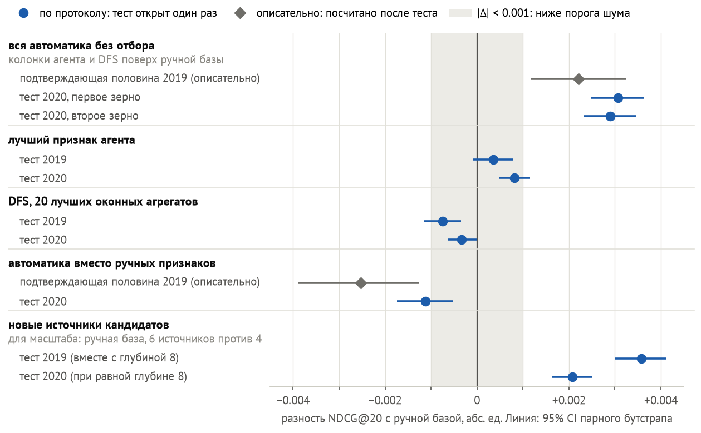

# Признаки LLM-агента и DFS поверх ручных помогают CatBoost на REES46 (+2.0% NDCG@20), но ручных не заменяют

Отбор T-Lab 2026, RecSys, задача 1.

**Ответ.** Мы выбрали постановку: рекомендовать в интернет-магазине REES46 товары, новые для пользователя (обоснование в разд. 1). Ручную базу (CatBoost на 80 признаках, настроенный по одному гиперпараметру за раз) мы сравнили с двумя способами строить признаки автоматически: LLM-агентом, который пишет SQL, и сеткой оконных агрегатов DFS. Из вариантов с автоматическими признаками базу обыграла только вся автоматика без отбора: все колонки агента и DFS поверх ручных признаков (рис. 1). На свежем тесте 2020 она дала +2.0% NDCG@20 к базе (+0.0030), доверительный интервал (CI) выше нуля в обоих запусках с разным зерном [по протоколу]. Гипотезу о ней мы записали после теста 2019 и проверили один раз. Прирост лучшего признака агента ниже порога шума ≈0.001, у лучших колонок DFS прироста нет, а замена ручных признаков автоматикой при настройках базы дала −0.77% на тесте 2020 [по протоколу]. На других наборах колонки агента подняли базу на отложенных неделях Tinkoff и СберМаркета [holdout с отклонением], но на Kaggle у Tinkoff оказались ниже базы, а у H&M не различены [описательно].

- **[по протоколу]**: результат теста, открытого для вердикта один раз по замороженной спецификации, с 95% CI парного бутстрапа по запросам. Числа половин валидации до теста 2019 считаются этапами этого протокола, метки у них нет.
- **[holdout с отклонением]**: правило решения записано заранее, но отложенные данные (holdout) открыты с отступлением от предрегистрации (разд. 3).
- **[описательно]**: без проверки по протоколу, в том числе всё посчитанное после теста.
- **[исследовательский]**: OTTO-2 и OTTO-3, разведка на соревновании Kaggle OTTO (разд. 6). Неделю для выбора и неделю Kaggle там открывали много раз.

Рис. 1. Из вариантов с автоматическими признаками порог шума на тесте 2020 прошла только вся автоматика без отбора, а замена ручных признаков осталась ниже базы. Ромбы посчитаны после теста [описательно].

Табл. 1. Пункты условия ([пересказ](../task1-requirements.md)) и что по ним сделано.

| Пункт условия | Что сделано | Где |
|---|---|---|
| Воспроизводимый бустинг с хорошими ручными признаками | CatBoost на 80 ручных признаках, настроен по одному гиперпараметру за раз, сочетания не проверялись | разд. 2, 5 |
| Автоматизация генерации признаков либо альтернативный метод, превосходящий хорошо настроенный бустинг | LLM-агент и DFS. Поверх ручных признаков базу превзошла вся автоматика без отбора на тесте 2020 [по протоколу]. Отобранные признаки и замена ручных не превзошли [по протоколу] | разд. 5 |
| Экспериментальная проверка, отчёт с результатами и ограничениями | Решения на одной половине валидации, проверка на другой, каждый тест открыт для вердикта один раз | разд. 3, 8 |
| Данные для признаков до момента прогноза, без временных утечек | Признаки только из событий до момента рекомендации, построчный тест на утечки. Две найденные проблемы закрыты до использования | разд. 4 |

## 1. Задача и данные

Условие не предписывает ни набор, ни цель, ни горизонт, их мы выбрали сами.

- **Запрос и цель.** Набор REES46 содержит события интернет-магазина за октябрь–ноябрь 2019 и, для повтора во времени, за январь–февраль 2020. Момент рекомендации t наступает в начале дня, модель ранжирует товары, которых пользователь до t не касался. Цель: первая корзина или покупка такого товара за 24 ч. Покупки входят в цель, потому что журнал корзин неполон: у 56.0% первых покупок товара в октябре 2019 корзины перед ними нет. Метрику мы считаем по запросам: пользователям, активным за 48 ч до t и имеющим цель.
- **Метрика и разбиение.** NDCG@20 оценивает порядок первых 20 рекомендаций по всем целям запроса, включая не попавшие в кандидаты. В 2019 обучение идёт 15.10–07.11, валидация 08–13.11, тест 18–28.11 (72 709 запросов). Валидацию мы поделили по пользователям на половину для выбора и подтверждающую. Тест 2020: 14–29.02 (97 656 запросов) без 27–28.02, потому что журнал за 27.02 сломан.
- **Почему новые товары.** При цели «все покупки» правило без модели «сначала недавние товары пользователя» нашло 50 из 58 повторных покупок, а их пользователь сделал бы и без ленты. Цена выбора: прямые признаки «пользователь × товар», которые условие относит к пространству признаков, для кандидатов пусты.

## 2. Метод

**База.** Шесть источников кандидатов и 80 признаков в восьми группах. Источники: популярное, популярное в категориях и брендах пользователя, два вида соседей его недавних товаров по совместным просмотрам, переходы от просмотра к покупке. Модель: CatBoost с Logloss, глубина 8, 500 деревьев, два зерна генератора случайных чисел. NDCG@20 базы: 0.1442 на тесте 2019 и 0.1462 на тесте 2020 [по протоколу]. «Ручные» значит «спроектированные по спецификации»: их спроектировал Claude Code, автор предложил 3 из них. В базу вошли и идеи первого запуска агента, поэтому вклад автоматики с нуля мы не измерили.

**LLM-агент.** За шесть раундов LLM пишет предложения агента, то есть идею и SQL-запрос к DuckDB, дающий одну или несколько колонок. Песочница считает каждое предложение только по событиям до t, и база переобучается с ним. Предложение принимается, если на половине для выбора прирост больше 0.0005 и CI выше нуля на обоих зёрнах. Этот порог мягче порога шума и только пропускает предложение на подтверждающую половину. В промпте нет строк данных и ответов, со второго раунда в нём есть эффекты прошлых предложений, а `claude -p` работает без инструментов. Из 30 предложений с 66 колонками принято одно, его мы называем лучшим признаком агента.

**DFS (Deep Feature Synthesis).** Это контроль без LLM: 128 оконных агрегатов по товару, категории, бренду и пользователю. В модель идут 20 лучших по важности на обучении из 96 колонок, допущенных к отбору.

**Варианты.** С базой мы сравнивали четыре варианта: базу с лучшим признаком агента, базу с 20 лучшими колонками DFS, всю автоматику без отбора и автоматику вместо ручных признаков. Вся автоматика без отбора: база, 66 колонок агента и 128 DFS, всего 274 признака. Автоматика вместо ручных признаков: ранги товара в шести источниках кандидатов и вся автоматика, 200 признаков.

**Связь с работами.** Как в CAAFE (arXiv 2305.03403), LLM пишет код признаков, у нас это SQL по событиям до t. Завышение лучшего признака на половине для выбора мы по аналогии связываем с переобучением оценщика на валидации из LATTEArena (arXiv 2606.09004, v3, §5.3).

## 3. Протокол

Решения мы принимали на одной половине валидации, проверяли на другой и каждый тест открывали для вердикта один раз. Две модели мы сравниваем по разности NDCG@20 на одних запросах, с CI парного бутстрапа. Разброс зёрен CI не учитывает, поэтому каждый вариант обучен на двух зёрнах.

- **Порог шума ≈0.001.** Разность меньше порога мы не считаем установленной даже при CI выше нуля. Модели, отличающиеся только зерном, расходятся на подтверждающей половине до 0.0013, у 2 из 10 пар CI не накрывает ноль. Пары пересчитаны вне Git [описательно].
- **Тесты.** Тест открывается по предрегистрации: вариантам, порогам и правилам решения, записанным в Git до чисел. Гипотезу о всей автоматике без отбора мы сформулировали после теста 2019, в котором этого варианта не было. На подтверждающей половине она дала +0.0022 [описательно]. Правило для 2020 мы записали до теста: прирост от +0.0015 на каждом зерне при CI выше нуля. Гиперпараметры, колонки DFS и признак агента для 2020 мы взяли из 2019 без перевыбора.

**Отступления от протокола.**
- Первые 11 прогонов показывали и метрики подтверждающей половины, по нашей оценке в пользу базы.
- Глубину 8 база получила при CI выше нуля только на одном зерне, хотя агенту требовалось два, по нашей оценке тоже в пользу базы.
- Лучший признак агента вошёл в тест 2019, хотя на подтверждающей половине его прирост уже не подтвердился. Такой состав теста выбрал автор, в чью пользу это, неизвестно.
- Последнее дополнение к предрегистрации 2020 мы внесли, когда уже видели числа проверочного прогона на валидации. Варианты и пороги оно не меняло, в чью пользу это, неизвестно.
- В разборе подтверждающей половины 2019 правило для всей автоматики без отбора мы ужесточили после запуска прогонов, но до обучения её моделей: порог стал действовать на каждом зерне. Тогда мы видели только половину для выбора у одного прогона базы, и правка играет в пользу базы.
- Перенос (Табл. 3): мы открыли отложенные недели Tinkoff и СберМаркета и отправили первые посылки Tinkoff по общему разрешению автора, без отдельного разрешения на каждое.

**Сколько раз открывали данные.** Тест 2020 и отложенные недели Tinkoff и СберМаркета после вердиктов повторно использовал совет агентов (разд. 6). На половине для выбора базу мы оценили 27 раз, агента 38 раз (прошлые эффекты были в его промпте), DFS 2 раза. Подтверждающую половину 2019 и валидацию 2020 мы использовали и в разборах после теста 2019, поэтому их числа после него описательные.

## 4. Защита от утечек

Признаки читают только события до t. Будущее окно определяет только цели и то, какие запросы оцениваются, в признаки оно не попадает. Проверка утечек на днях 22.10 и 11.11.2019 и 22.01.2020 строит признаки дня по полному журналу и по журналу, обрезанному по t, и сравнивает все колонки построчно. SQL агента выполняется в песочнице DuckDB, где есть только события до t.

Постановка OTTO трансдуктивна: признаки видят более поздние события других сессий той же недели. Kaggle их выдаёт, а в онлайн-системе их нет.

Аудит SQL вёл отдельный экземпляр Claude без права правки. Аудитор Tinkoff до открытия отложенной недели посчитал корреляцию по событиям её окна цели, но набор агента был заморожен раньше. Остальные находки собраны в Табл. 2. Мы не утверждаем, что утечек нет: проверено только перечисленное.

Табл. 2. Две найденные проблемы закрыты до использования, расхождение в OTTO дали округления.

| Что нашли | Чем поймали | Как закрыли |
|---|---|---|
| REES46, 2020: код категории брался за весь период, а у 19 категорий он появляется только 01–05.02 | тест на утечки | код берётся из событий до t, таблицы 2020 пересобраны до обучения моделей |
| обход песочницы через функцию DuckDB `json_execute_serialized_sql` | ревью кода | закрыт до первого раунда агента |
| OTTO: 4 колонки агента разошлись между полным журналом и журналом без продолжений сессий | тест на утечки | порядок округлений при параллельном суммировании, в один поток проверка прошла |
| скрытое использование ответов в SQL агента | аудит SQL | не найдено в OTTO и при переносе. На REES46 его заменяет песочница |

## 5. Результаты на REES46

Поверх ручной базы помогла только вся автоматика без отбора (рис. 1).

- **Вся автоматика без отбора.** На тесте 2020 она дала +0.0031 и +0.0029 по зёрнам, правило требовало +0.0015 на каждом [по протоколу]. К базе это +2.0%. На всех 16 днях, включая 27 и 28.02, вердикты те же.
- **DFS, 20 лучших колонок.** DFS прироста не дал: −0.0008 и −0.0003 на тестах, обе разности меньше порога. CI ниже нуля оба раза, во втором вплотную к нулю [по протоколу].
- **Плацебо.** После обоих тестов мы перемешали те же 194 колонки по строкам внутри дня: число и распределения колонок прежние, связь с парой пользователь–товар разрушена. На валидации настоящие колонки лучше перемешанных на 0.0025–0.0043 [описательно]. Перемешанные меняют базу на −0.0008…−0.0003 [описательно]. Значит, прирост несёт содержание колонок. По разложению на тех же данных его несут в основном колонки агента, одни DFS базу не поднимают [описательно]. На 2019 эта оценка вклада агента смещена: его предложения подбирались по половине для выбора 2019. На тесте состав прироста не разделён.
- **Кандидаты.** В кандидаты не попадает около половины целей и больше: ≈48% на валидации 2019 по ночному журналу [описательно]. По разбору после теста на 29.01–02.02.2020 их ≈58% [описательно]. Новые источники кандидатов дали на тесте 2019 наибольший прирост, +0.0036 вместе с глубиной 8, а на тесте 2020 при равной глубине повторились, +0.0021 [по протоколу]. Источники входят в ручную базу, агент на REES46 пишет только признаки.

**Лучший признак агента и завышение при отборе.** Даже если ни одно предложение не работает, лучшее из 30 на половине для выбора в среднем показывает около +0.0008 [описательно]. Лучший признак агента дал там +0.0013 и +0.0017 по зёрнам. На подтверждающей половине осталось +0.0004, и CI накрыл ноль. На тестах вышло +0.0004 и +0.0008 [по протоколу]: в 2019 CI накрыл ноль, в 2020 CI выше нуля, но прирост ниже порога и не установлен. Завышение поймала подтверждающая половина, порог приёма его пропустил. Прямого теста «пошагово против всего сразу» у нас нет: оба числа сравнивают с базой, а вся автоматика включает и DFS. В разборе после теста мы принимали предложения агента группами по пять, и на половине для выбора прошла одна группа. На подтверждающей половине её отставание от всех предложений агента сразу ниже порога шума [описательно]. Синергия это или сумма мелких эффектов, мы не различили.

**Замена ручных признаков.** Если оставить из ручных только ранги источников, база теряет 0.0167 на тесте 2020 [по протоколу] и 0.0171 на подтверждающей половине 2019 [описательно]. Автоматика вместо ручных признаков возвращает 93% этого вклада на тесте 2020 [по протоколу] и 85% на подтверждающей половине 2019 [описательно]. Но до базы она не дотягивает: −1.68% к базе на подтверждающей половине 2019 [описательно] и −0.77% на тесте 2020 [по протоколу], CI ниже нуля оба раза. Одни колонки агента возвращают 78% вклада, одни DFS 25%, оба числа на подтверждающей половине 2019 [описательно]. Оценка для агента смещена по той же причине, что в плацебо. На тесте 2020 разность −0.0011 лишь чуть больше порога [по протоколу]. Вариант на 200 признаках мы не перенастраивали, поэтому вывод относится к настройкам базы.

**Насколько настроен бустинг.** До теста мы настраивали базу по одному гиперпараметру за раз на половине для выбора и сочетаний не проверяли. Глубину 8 мы приняли, 1000 деревьев и трудные негативы отвергли. После теста выигрыша не дали глубина 10 и YetiRank у базы, пять значений трёх гиперпараметров у всей автоматики и ранняя остановка у обеих [описательно]. Что база вышла на плато, это не доказывает. Бюджеты мы не выравнивали: ручная настройка заняла 16 подгонок, ≈2.1 ч, а агент ≈4.8 ч. Недонастройка базы облегчает выигрыш автоматике, но автоматику вместо ручных признаков, плацебо, перенос и совет мы тоже не настраивали.

## 6. Границы вывода

### Перенос на H&M, Tinkoff и СберМаркет

Мы переносили только агентскую часть: новый запуск агента на наборе и все его валидные колонки поверх ручной базы набора, без DFS и без перенастройки бустинга.

Табл. 3. На Kaggle рост от колонок агента у Tinkoff не повторился, у H&M не различён, у СберМаркета не проверялся. Колонки агента поверх базы набора, в процентах к базе.

| Набор | Отложенные данные | Kaggle private |
|---|---|---|
| Tinkoff, NDCG@20 | +6.2% и +3.6% по зёрнам [holdout с отклонением] | ниже базы, ≈−7.6% [описательно] |
| СберМаркет, MAP@50 | +2.6% на обоих зёрнах [holdout с отклонением] | не проверен: на Kaggle колонки чаще пусты, чем на обучении, и не отправлялись |
| H&M, MAP@12 | отложенной недели нет, неделя валидации +8.9% [описательно] | не различено [описательно] |

Технические отклонения переноса мы записали в Git позже, чем применили, на значения это не влияет. Базы собрал Claude Code, который знает эти соревнования, поэтому знание публичных решений не исключено. Промпт агента соревнование не называет, но схема данных узнаваема. На отложенных неделях запросом считается пользователь с целью в окне, а Kaggle оценивает другую популяцию.

У Tinkoff прирост есть только на отложенной неделе: на валидации CI накрывает ноль, на Kaggle колонки ниже базы на обоих зёрнах, причины мы не проверяли. У H&M нет свежей отложенной недели: неделя валидации была отложенной в прежнем эксперименте. MAP@12 на ней считается только по 1 905 покупателям, CI второго зерна накрывает ноль, а на Kaggle больше половины клиентов получают одинаковый популярный ответ. Промпт агента на H&M набор не скрывает, и LLM знает решения этого соревнования. Если эффекта нет, наше правило сравнения посылок на Kaggle ошибается примерно в 11% случаев в каждую сторону, а прирост такой величины, как на REES46, при двух зёрнах не различает. Мест на лидербордах мы не заявляем ни здесь, ни в OTTO: все посылки поздние.

### Совет агентов

В [совете агентов](../task1-v2-council.md) LLM-генераторы и критики предлагают семейства признаков поверх всей автоматики без отбора, отбор вычёркивает вредные, и результат сравнивается с моделью на том же числе признаков без отбора. Ожидаемый исход «не различено» мы записали в предрегистрации до кода, и он вышел на уже открытых данных: тесте REES46 2020 и отложенных неделях Tinkoff и СберМаркета [описательно]. Отбор совета не включился ни на одном наборе, поэтому мы проверили только генерацию. Эффекты меньше разрешения теста не исключены.

### OTTO, где агент строит и кандидатов

На соревновании Kaggle OTTO по началу сессии нужно предсказать до 20 товаров для кликов, корзин и заказов, а Score взвешивает их Recall@20. На вопрос о настроенном бустинге OTTO не отвечает, потому что база там намеренно простая: история сессии, популярность и ранкер без настройки. Агент пишет SQL таблиц «товар × товар», источников кандидатов и признаков в лимитах на раунды, источники и кандидатов на сессию. Двухэтапную схему, лимиты, ранкер и правила выбора и остановки задал Claude Code, а итерации шли по просьбам автора. Потолок кандидатов: Score по всем кандидатам сессии, верхняя граница для ранкера.

На шагах OTTO-2 и OTTO-3 посылку мы выбирали правилом, записанным заранее, но у OTTO-2 смена порядка двух посылок попала в Git только вместе с результатом первой. На неделе для выбора приросты шагов OTTO-3 больше разброса от выборки сессий (рис. 2) [исследовательский]. Их 95% CI выше нуля, но без учёта отбора по неделе для выбора, зерна модели и запуска агента. У последнего шага CI по заказам задевает ноль. На том же ранкере новые наборы агента в расширенных лимитах дали больше, чем переобучение ранкера. Этот прирост шёл вместе с ростом потолка кандидатов, вклад не разделён. Лучший private 0.5963 <!--OTTO-BEST--> дала итерация 3 (Табл. 4) [исследовательский], итераций после неё не было.

Табл. 4. Каждый шаг OTTO поднял Score на неделе для выбора и на private. Уровни недели для выбора и private несравнимы, сравнимы приросты. Private простой базы и OTTO-1 усреднён по двум зёрнам. Простая база и OTTO-1 [описательно], OTTO-2 и OTTO-3 [исследовательский].

| Шаг | Неделя для выбора | Потолок кандидатов | Private |
|---|---:|---:|---:|
| простая база | 0.4778 | 0.4824 | 0.4906 |
| OTTO-1: кандидаты и признаки агента | 0.5633 | 0.6039 | 0.5788 |
| OTTO-2: переобучен только ранкер | 0.5653 | 0.6039 | 0.5805 |
| OTTO-3, итерация 1: новый прогон агента, шире лимиты | 0.5777 | 0.6514 | 0.5930 |
| OTTO-3, итерация 2: итерация 1 и 18 новых предложений агента | 0.5802 | 0.6639 | 0.5955 |
| OTTO-3, итерация 3: итерация 2 и 20 новых предложений, только признаки | 0.5810 | 0.6639 | 0.5963 |

Рис. 2. Приросты за шаг на неделе для выбора и на private совпали по знаку на каждом шаге, а по величине разошлись не больше чем на 0.0006, кроме первого шага. CI без учёта отбора на неделе для выбора.

У шагов OTTO три ограничения.
- Это не проверка по протоколу. По предрегистрации простая база должна была быть не хуже правила без модели по каждому типу действий, а по кликам она уступила 0.0016 [описательно]. Сравнение мы перенесли на общий Score после чисел недели для выбора, с согласия автора, поэтому числа отложенной недели и недели Kaggle подтверждением по протоколу не служат. На неделю Kaggle ушло 9 <!--F5-READS--> посылок. Правило «стоп при private ≥ 0.590», записанное до результатов, сработало на итерации 1, но по просьбе автора мы отправили ещё две итерации, до заранее записанного предела.
- Придумано это или вспомнено, не различается. Аудитор по памяти счёл общеизвестными большинство предложений в каждом прогоне агента. Один признак итерации 2, по его памяти, повторяет веса типов действий из публичного решения. Пересказ части одного из публичных решений попал в журнал исследования до предрегистрации OTTO. Промпт соревнование не называет, с решениями мы не сверяли. Claude Code тоже знает OTTO.
- Это не один эксперимент. Простую базу с ранкером OTTO-2 мы не обучали, шаг к итерации 1 смешивает новые лимиты и новый запуск агента, а на каждый набор приходится один прогон агента и одна модель. Неделя для выбора смещена: агент видел recall на пробе той же недели, по ней мы выбирали варианты и итерации, и её события есть в истории финальных моделей. Несмещённую оценку даёт только private. Постановка OTTO трансдуктивна (разд. 4).

### Выводы по наборам

Табл. 5. Рост от всей автоматики по протоколу проверен только на REES46, а на Kaggle он не подтвердился там, где его проверяли. Остальные выводы разд. 5 сделаны только на REES46. Прочерк: не проверялось.

| Вывод | REES46, тест 2020 | H&M | Tinkoff | СберМаркет |
|---|---|---|---|---|
| вся автоматика поверх базы¹ | рост [по протоколу] | рост [описательно] | рост [holdout с отклонением] | рост [holdout с отклонением] |
| то же на Kaggle | — | не различено [описательно] | ниже базы [описательно] | не проверен |
| совет против равного числа признаков без отбора | не различено [описательно] | — | не различено [описательно] | не различено [описательно] |

¹ На REES46 колонки агента и DFS, на других наборах только колонки нового запуска агента.

## 7. Сколько стоит агент

Генерировать признаки дёшево, отбирать дорого и трудно. Агент работал на REES46 ≈4.8 ч. LLM заняла 5.8% этого времени и стоила $2.89 по оценке `claude -p`. Больше всего ушло на переобучение базы: в среднем 406 с на предложение против ≈34 с у LLM. Сотням предложений нужны дешёвая оценка, подтверждающая половина в цикле и поправка на множественные проверки.

## 8. Ограничения

- Один магазин: по протоколу проверен только REES46 (разд. 6).
- Главный результат: один тест 2020 и два зерна, повтора во времени нет (разд. 3).
- Бустинг настроен по одному гиперпараметру за раз, бюджеты не выравнивались (разд. 5).
- Разброс зёрен для порога шума пересчитан вне Git (разд. 3).
- Оба тестовых периода REES46 уже открыты, свежего теста не осталось (разд. 3).

## 9. Участие ИИ

Автор выбрал задачу 1 и проверку гипотез, возразил против первой постановки и предложил цель «первая корзина или первая покупка» и 3 из 80 признаков. Из двух направлений, предложенных Claude Code, он выбрал работу над кандидатами, выбрал спецификацию теста 2019 с лучшим признаком агента и сам его запустил. Тест 2020 запустил Claude Code по разрешению автора, и гипотезу для этого теста Claude Code тоже записал сам. Потом автор попросил повтор на других наборах и сравнение с Kaggle, предложил совет, поставил цель OTTO, разрешал открывать тесты и отправлять посылки и перевёл работу в автономный режим.

Claude Code предложил ограничиться новыми товарами, спроектировал источники и остальные признаки, написал весь код и документы, в том числе предрегистрации до чисел. Он задал устройство переноса, совета и OTTO. В автономных прогонах по правилам предрегистрации он сам выбрал устройство DFS с отбором 20 лучших, порог приёма агента и три варианта теста 2019.

Роли пересказал Claude Code. Стенограммы переписки в репозитории нет, дословно записаны только разрешения автора. Ревью вели отдельные экземпляры Claude без права правки. Они ловят ошибки счёта и расхождения с артефактами, но не общие слепые зоны одной модели.

## Приложения

- [Журнал исследования](../task1-v2-report.md): все варианты, абляции, затраты, глоссарий. [OTTO-3](../otto3.md): итерации агента, правила посылок и остановки.
- [Сводка чисел](facts.md): каждое число этого текста с меткой и источником.
- Воспроизведение [задачи 1](../task1-reproduce.md) и [OTTO](../otto-reproduce.md): от сырых файлов до чисел тестов и посылок.

Репозиторий: github.com/suprend/tlab-recsys-2026-task1, ссылки ведут на коммит сдачи в `main`.
